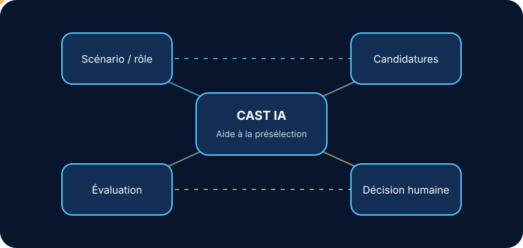

<div align="center">



<br/>

# 🎬 Cast IA

### La présélection des talents, avec l’humain au cœur du casting.

**Prototype pour le Hackathon IA Éthique 360**  
**JEI INSAT × OIF · Mandat JEI 2026/2027**

<p>
  
  
  
  
</p>

<p>
  <a href="#-le-projet">Le projet</a> ·
  <a href="#-parcours-de-casting">Parcours</a> ·
  <a href="#-aperçu-animé">Aperçu animé</a> ·
  <a href="#-démo-vidéo">Démo vidéo</a> ·
  <a href="#-technologies">Technologies</a> ·
  <a href="#-installation">Installation</a>
</p>

</div>

---

## 🎭 Le projet

**Cast IA** est une plateforme d’aide à la présélection des candidatures destinée aux producteurs et aux directeurs de casting. Elle vise à faciliter l’organisation des castings, la réception des auditions et l’identification des profils correspondant aux rôles proposés.

Développé comme prototype dans le cadre du **Hackathon IA Éthique 360 (JEI INSAT × OIF — Mandat JEI 2026/2027)**, le projet explore la place d’un outil numérique d’assistance dans le processus de casting.

> **L’outil assiste. Le directeur de casting décide.**  
> La décision finale reste humaine.

## 🕸️ Aperçu animé

<div align="center">



<sub>Animation vectorielle originale — visualisation conceptuelle du parcours de casting.</sub>

</div>

## ✨ Objectif & parcours de casting

<div align="center">

| 01 · Définir | 02 · Candidater | 03 · Évaluer | 04 · Décider |
|:---:|:---:|:---:|:---:|
| 🎬 Définition du scénario et des rôles | 🎥 Inscription et dépôt d’audition | 📝 Évaluation et commentaire | 🧑‍⚖️ Consultation et décision du directeur |

</div>

Le parcours cible du projet :

1. Le directeur de casting crée un scénario et décrit les rôles associés.
2. Les candidats s’inscrivent et soumettent leurs auditions vidéo.
3. Les auditions peuvent être évaluées manuellement par le directeur, avec une note sur 100 et un commentaire.
4. Un classement des 15 meilleurs candidats par rôle est prévu dans le parcours.
5. Le directeur de casting conserve la décision finale.

## 🎬 Démo vidéo

<div align="center">

> **La vidéo de démonstration sera ajoutée ici.**
>
> Une capture vidéo du prototype pourra être intégrée à cette section afin de présenter le parcours candidat et l’espace de casting.

<!-- Pour intégrer une vidéo hébergée par GitHub : téléversez un fichier MP4 dans un commentaire ou une issue, puis remplacez ce texte par son URL user-attachments. -->

</div>

## ⚖️ Une démarche responsable

Cast IA est conçu comme un **outil d’aide à la présélection**, et non comme un décideur autonome.

- **Supervision humaine :** le directeur de casting conserve la décision finale.
- **Évaluation contrôlable :** l’évaluation manuelle s’accompagne d’une note et d’un commentaire.
- **Transparence sur le prototype :** les éléments de démonstration et les fonctionnalités en cours de développement sont signalés.

*L’analyse automatique des auditions par IA n’est pas encore implémentée dans le prototype actuel.*

## 🧩 Fonctionnalités disponibles dans le backend

- Gestion des comptes candidat et directeur de casting.
- Inscription des candidats.
- Création et consultation des scénarios de casting.
- Création et gestion des rôles associés aux scénarios.
- Dépôt et consultation des auditions vidéo.
- Évaluation manuelle des auditions par le directeur de casting, avec une note sur 100 et un commentaire.
- Endpoint de classement Top 15 par rôle.
- Contrôle des permissions selon le type de compte.

## 🚧 État du prototype

Cast IA est en développement. Les fonctionnalités backend décrites ci-dessus sont présentes sur la branche de travail. **L’évaluation automatique par IA n’est pas encore développée** : les évaluations du parcours actuel sont manuelles. L’interface frontend contient également des éléments de démonstration qui peuvent utiliser des données fictives.

## 🏗️ Architecture du dépôt

```text
spider-el-3ankabout/
├── backend/
│   ├── applicants/       # Inscription et profils candidats
│   ├── casting/          # Scénarios, rôles et permissions
│   ├── evaluations/      # Auditions, évaluations et classement
│   ├── config/           # Configuration Django
│   ├── requirements.txt  # Dépendances du backend
│   ├── requirements-ai.txt
│   └── docker-compose.yml
├── frontend/
│   ├── src/              # Application React
│   └── package.json
├── docs/
│   └── assets/           # Visuels et animations du README
└── README.md
```

## 🛠️ Technologies

<div align="center">

| Domaine | Technologies |
|---|---|
| Backend & API | Python · Django · Django REST Framework |
| Frontend | React · Vite · JavaScript |
| Base de données | SQLite (configuration de développement) |
| Traitements asynchrones | Celery · Redis (configuration du projet) |
| Audio — choix prévu | librosa |

</div>

## 🚀 Installation

### 1. Cloner le dépôt

```bash
git clone https://github.com/ismailkrid957-dot/spider-el-3ankabout.git
cd spider-el-3ankabout
```

### 2. Démarrer le backend

Depuis le dossier `backend` :

```powershell
python -m venv .venv
.\.venv\Scripts\Activate.ps1
pip install -r requirements.txt
Copy-Item .env.example .env
python manage.py migrate
python manage.py runserver
```

Le backend est accessible à l’adresse : [http://127.0.0.1:8000/](http://127.0.0.1:8000/).

### 3. Démarrer le frontend

Dans un second terminal, depuis le dossier `frontend` :

```bash
npm install
npm run dev
```

Le frontend est accessible à l’adresse : [http://localhost:5173/](http://localhost:5173/).

### 4. Redis (facultatif pour le démarrage de base)

Depuis le dossier `backend`, si Docker est installé :

```bash
docker compose up -d
```

## 🧪 Tests

Pour lancer les tests du backend depuis le dossier `backend` :

```bash
python manage.py test
```

Sur la branche de travail, la suite de tests Django a été exécutée avec succès : **8 tests passés**.

## 🤝 Cadre du projet

<div align="center">

**Hackathon IA Éthique 360**  
**JEI INSAT × Organisation internationale de la Francophonie (OIF)**  
*Mandat JEI 2026/2027*

</div>

Ce dépôt présente le prototype académique et technique **Cast IA**. Les fonctionnalités sont documentées selon leur état réel de développement.

---

<div align="center">

### 🕷️ Cast IA · Une toile de talents, une décision humaine.

<sub>Prototype du Hackathon IA Éthique 360 — JEI INSAT × OIF · 2026/2027</sub>

</div>
